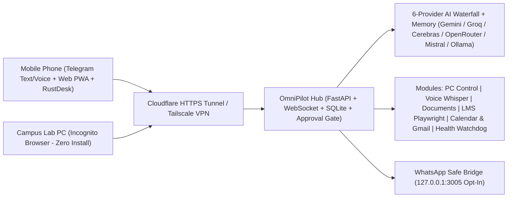

# OmniPilot Hub

[](https://www.python.org/)
[](https://fastapi.tiangolo.com/)
[-339933?logo=node.js&logoColor=white)](https://nodejs.org/)
[](https://www.microsoft.com/windows)

**Personal AI Automation Hub & Zero-Install Remote PC Command Center for Windows.**

OmniPilot Hub turns your home Windows laptop into a remotely controllable, AI-powered automation workstation accessible from your **phone (Android/iOS)** or **any public/campus lab PC browser**—without requiring VPN installs or admin privileges on remote computers.

Control your PC through natural language or **voice notes** on **Telegram**, or manage everything visually from a weightless **Glassmorphism Web Command Center (PWA)** with real-time WebSocket updates, built-in interactive screen control, a 6-provider free-tier AI waterfall with conversation memory, automated document generation, persistent LMS automation, safe WhatsApp/Gmail workflows, and a 24/7 laptop health watchdog.

---

## Key Features

### 1. Dual Remote Interfaces (Mobile & Desktop)
- **Glassmorphism Web Command Center (PWA)**: Mobile-first dark frosted-glass UI installable directly to your phone's Home Screen. Includes live WebSocket events, quick action chips, interactive screen preview, document downloads, approval queue, and a dedicated **Public/Lab PC Mode** (`sessionStorage`-only token + one-click **Logout**).
- **Private Telegram Bot (`text` + `voice`)**: Locked strictly to your Telegram User ID. Supports natural-language prompts, **Voice Note transcription** (Groq Whisper with Gemini multimodal fallback), `/screen` live desktop snapshots, and inline buttons for **Approve / Reject** and **Acknowledge Alarm**.

### 2. 6-Provider Free-Tier AI Waterfall + Multi-Turn Memory
- **Automatic Cascading Failover**: Never get stuck on `429` quota limits or `503` overload errors. OmniPilot automatically cascades across configured providers in order:
  1. **Google Gemini** (`gemini-3.5-flash-lite`, `gemini-3.1-flash-lite`, plus fallback models)
  2. **Groq** (`llama-3.3-70b-versatile`, `llama-3.1-8b-instant`, `qwen/qwen3-32b`)
  3. **Cerebras** (`llama3.1-8b`, `gpt-oss-120b`)
  4. **OpenRouter `:free`** (`llama-3.3-70b-instruct:free`, `gemma-3-27b-it:free`, `qwen3`)
  5. **Mistral AI** (`mistral-small-latest`)
  6. **Ollama** (Local `http://127.0.0.1:11434/v1` offline unlimited, or Ollama Cloud `https://ollama.com/v1`)
- **Persistent Conversation & Fact Memory**: Remembers the last 10 turns per channel plus long-term personal facts (`/ingat`, `/memori`, `/lupa`, `/reset`) so follow-up prompts stay contextual.
- **14 Built-in AI Tools**: Launch desktop apps, generate documents, query PC telemetry, manage schedules & timers, run guarded PowerShell commands, inspect LMS deadlines, queue Gmail/WhatsApp drafts, inspect/close heavy RAM processes, remember facts, and lock your laptop screen.

### 3. Zero-Install Remote Screen & Public Internet Tunneling
- **One-Click Public HTTPS Access (`START_ALL.bat`)**: Automatically ensures the local FastAPI hub is running, launches an ISP-friendly **Cloudflare Tunnel (`HTTP/2 IPv4`)**, highlights the public `https://*.trycloudflare.com` URL, copies it straight to your Windows clipboard, and delivers it directly to your Telegram bot.
- **Interactive Browser Mouse & Keyboard**: Click, double-click, right-click, scroll, type Unicode text, send hotkeys (`Alt+Tab`, `Ctrl+C/V/S`, `Enter`, `Win`), and lock your home laptop directly from an Incognito browser tab on any campus lab PC—powered natively by Windows Win32 APIs with zero extra bloat.
- **High-FPS Companion Support**: Built-in setup scripts and quick references for **Tailscale** (private mesh VPN + optional permanent Funnel URL), **RustDesk**, **Sunshine/Moonlight**, and **Chrome Remote Desktop**.

### 4. Human-in-the-Loop Approval Gate & System Watchdog
- **Mandatory Approval Gate**: Every high-impact action—sending Gmail, replying on WhatsApp, uploading LMS assignments, executing destructive PowerShell commands, or closing running apps (`/kill`)—pauses in an approval queue until you explicitly tap **Approve** in Telegram or the PWA.
- **Laptop Health Watchdog**: Monitors RAM, battery (when unplugged), disk usage, and bridge connectivity in the background, alerting you on Telegram before your laptop freezes or runs out of power. Includes `/top` (top RAM consumers) and `/kill <process>` (with Windows core & remote-access process protection).
- **Daily Schedule & 3-Stage Escalation Alarm**: Combines local SQLite schedules with Google Calendar (`.ics`), phone check-in heartbeats (`/api/phone/heartbeat`), and optional 3-stage escalation alarms (`ntfy` + MacroDroid / Pushover Priority 2 / local PC siren).

### 5. Academic & Communications Automation
- **Automated Document Generator**: Creates clean `.docx`, `.pdf`, and `.md` files stored in `outputs/documents/` and immediately downloadable from your phone or lab PC.
- **Persistent-Session LMS Automation (Playwright)**: Log in once via a visible Chromium profile (`4_LOGIN_LMS.bat`) so SSO/2FA cookies stay local in `data/browser_profile/` without storing raw passwords. Inspect deadlines and stage assignment uploads behind the Approval Gate.
- **WhatsApp Safe Bridge (Opt-In)**: Isolated localhost-only (`127.0.0.1:3005`) Node.js bridge using `@whiskeysockets/baileys` v7 with natural typing delays (2.5–5.5s), outbound cooldowns (10s), and strict Approval Gate enforcement to protect personal numbers.

---

## System Architecture



---

## Project Structure

```text
OmniPilot/
├── 0_SETUP_ENV_WIZARD.bat       # Interactive .env setup wizard (no manual file editing)
├── 1_SETUP_LAPTOP_ADMIN.bat     # Automated Windows setup (venv, pip, Tailscale, cloudflared, RustDesk, Firewall)
├── 2_START_HUB.bat              # Start local/Tailscale server + display phone pairing QR code
├── 3_START_CAMPUS_TUNNEL.bat    # Start public Cloudflare HTTPS tunnel (auto-starts Hub if needed)
├── 4_LOGIN_LMS.bat              # One-time visible browser login to save LMS SSO/2FA session
├── 5_START_WHATSAPP_BRIDGE.bat  # Opt-in localhost WhatsApp Safe Bridge + QR pairing
├── START_ALL.bat                # Master 1-click launcher (Hub + Public Tunnel + Clipboard + Telegram link)
├── .env.example                 # Complete annotated configuration template
├── requirements.txt             # Pinned Python dependencies
├── backend/
│   ├── main.py                  # FastAPI REST API, WebSocket event stream, and PWA static host
│   ├── core/                    # Config, security auth, SQLite DB, Approval Gate, AI Agent Engine, runtime state
│   ├── modules/                 # PC control, voice Whisper, health watchdog, scheduler/alarm, docs, LMS, Gmail, WA
│   └── interfaces/              # Async Telegram Bot (text, voice notes, screenshots, inline callbacks)
├── frontend/                    # Weightless Glassmorphism Mobile-First PWA (HTML/CSS/ES6 modules, zero build step)
├── whatsapp-bridge/             # Isolated Node.js ESM Baileys v7 bridge (127.0.0.1:3005 only)
├── scripts/                     # Setup wizard, PowerShell installers, tunnel supervisor, OAuth & LMS helpers
├── docs/                        # Detailed Laptop/Mobile/Campus setup guide & v2 development roadmap
└── tests/                       # Automated pytest suite
```

---

## Quick Start (Fresh Clone to Running in 3 Minutes)

### Prerequisites
- **Windows 10 or 11**
- **Python 3.10+** — Download from [python.org](https://www.python.org/downloads/) (check **"Add python.exe to PATH"** during installation).
- **Node.js 20+** *(Optional)* — Only needed if you enable the WhatsApp Safe Bridge.

### Step 1: Clone the Repository
```bash
git clone https://github.com/PutuSatria-hash/OmniPilot.git
cd OmniPilot
```

### Step 2: Run the Automated Windows Installer
Double-click **`1_SETUP_LAPTOP_ADMIN.bat`** (accept the Administrator prompt), or run in an elevated PowerShell window:
```powershell
powershell -ExecutionPolicy Bypass -File ".\scripts\setup_laptop.ps1" -RemoteDesktop RustDesk -CampusTunnel Both -DisableSleepOnAC -EnableAutoStart
```
This automatically:
1. Creates `.venv` and installs all Python dependencies from `requirements.txt`.
2. Bootstraps `.env` from `.env.example` with a cryptographically random `API_AUTH_TOKEN`.
3. Installs **Tailscale**, **Cloudflare Tunnel (`cloudflared`)**, **RustDesk**, and **Playwright Chromium**.
4. Configures Windows Firewall port `8787` (restricted to Tailscale & local subnet) and disables AC auto-sleep.

### Step 3: Configure `.env` with the Interactive Setup Wizard
Double-click **`0_SETUP_ENV_WIZARD.bat`** (or run `.\.venv\Scripts\python.exe scripts\setup_wizard.py`).
- Follow the step-by-step prompts to add at least one free AI key (Gemini / Groq) and your Telegram Bot token.
- Press **Enter** to skip any optional integration or keep an existing value.
- Existing secrets are masked automatically when re-running the wizard.

### Step 4: Launch OmniPilot Hub
- **For Public Internet + Campus Lab + Phone Access (Recommended)**: Double-click **`START_ALL.bat`**.
  - Starts the FastAPI server automatically, opens a public `https://*.trycloudflare.com` tunnel, copies the public URL to your clipboard, and sends both the public link and your private instant-login link to your Telegram bot.
- **For Private Local / Tailscale Access with Phone QR Code**: Double-click **`2_START_HUB.bat`** and scan the QR code shown in the terminal with your phone camera.

---

## Environment Configuration Reference (`.env`)

All settings live in `.env` (auto-created by `0_SETUP_ENV_WIZARD.bat` or copied manually from `.env.example`). Never commit `.env` to Git.

| Variable | Required | Description & Where to Obtain |
| :--- | :--- | :--- |
| `API_AUTH_TOKEN` | **Yes** | Secret bearer token protecting the Web PWA, REST API, and WebSockets (auto-generated by the setup wizard). |
| `PORT` | Optional | Local server port (default `8787`). |
| `TIMEZONE` | Optional | IANA timezone for schedules & briefings (default `Asia/Makassar`; e.g., `Asia/Jakarta`, `UTC`). |
| `GEMINI_API_KEY` | Recommended | Free API key from [Google AI Studio](https://aistudio.google.com/app/api-keys). |
| `GEMINI_MODEL` | Optional | Primary Gemini model (default `gemini-3.5-flash-lite`). |
| `GROQ_API_KEY` | Recommended | Free API key from [Groq Console](https://console.groq.com/keys) — powers fast **Voice Note (Whisper)** transcription and high-speed fallback chat. |
| `OPENROUTER_API_KEY` | Optional | Free `:free` model fallback from [OpenRouter](https://openrouter.ai/keys). |
| `CEREBRAS_API_KEY` | Optional | High-throughput free developer tier from [Cerebras Cloud](https://cloud.cerebras.ai). |
| `MISTRAL_API_KEY` | Optional | Free evaluation tier from [Mistral Console](https://console.mistral.ai/api-keys). |
| `OLLAMA_MODEL` / `OLLAMA_API_KEY` | Optional | Local offline models (`http://127.0.0.1:11434/v1`) or Ollama Cloud models (`https://ollama.com/v1` with key from [ollama.com/settings/keys](https://ollama.com/settings/keys)). |
| `TELEGRAM_BOT_TOKEN` | Recommended | Create a bot via `@BotFather` (`/newbot`) on Telegram. |
| `TELEGRAM_ALLOWED_USER_ID` | Recommended | Your numeric Telegram ID (from `@userinfobot`) to lock bot access strictly to yourself. |
| `GOOGLE_CALENDAR_ICS_URL` | Optional | Google Calendar -> *Settings* -> *Integrate calendar* -> **Secret address in iCal format** (`/private-.../basic.ics`). |
| `LMS_BASE_URL` | Optional | Your university/school LMS dashboard URL. Run `4_LOGIN_LMS.bat` once to save your browser session. |
| `RUSTDESK_PC_ID` | Optional | Your 9-digit RustDesk PC ID (never store your RustDesk password in `.env`). |
| `WHATSAPP_ENABLED` | Optional | Default `false`. Set to `true` only after launching `5_START_WHATSAPP_BRIDGE.bat` and linking via QR. |
| `NTFY_TOPIC` / `MACRODROID_WEBHOOK_URL` | Optional | Free Android bypass-silent escalation alarm channels. |
| `PUSHOVER_APP_TOKEN` / `PUSHOVER_USER_KEY` | Optional | Cross-platform iOS/Android Critical Alerts (Priority 2) alarm channels. |
| `REMOTE_INPUT_ENABLED` | Optional | Enables/disables browser-based Win32 mouse & keyboard control (`true` / `false`). |

---

## Remote Access Modes

| Scenario | Recommended Method | Setup Needed on Remote Device |
| :--- | :--- | :--- |
| **Daily Phone Control (Fastest)** | Telegram Bot (Text + Voice Notes) + Installed Web PWA | Telegram app + optional Tailscale |
| **Campus Lab / Public PC (Zero-Install)** | Open `https://*.trycloudflare.com` (from `START_ALL.bat`) in **Incognito**, check **Public/Lab PC Mode**, use **PC & Screen** tab, click **Logout** when done | **None** (Browser only) |
| **Full 60 FPS Desktop from Phone / 2nd PC** | Tailscale + RustDesk (Direct IP port `21118`) or Chrome Remote Desktop (`remotedesktop.google.com/access`) | RustDesk / Chrome browser |
| **Permanent Public HTTPS URL** | `.\scripts\start_campus_tunnel.ps1 -Mode TailscaleFunnel` | **None** (Browser only; requires enabling Funnel once in Tailscale DNS settings) |

---

## Command Reference (Telegram & Web Chat)

| Command | Action |
| :--- | :--- |
| *Any natural text / Telegram Voice Note* | Handled by the multi-provider AI agent with conversation memory & 14 PC/automation tools |
| `/pc` | Real-time CPU, RAM, disk, battery, local IP, and Tailscale IP status |
| `/top` | List top RAM-consuming applications on your laptop |
| `/kill <app.exe \| PID>` | Request closing a heavy non-system application (protected by Approval Gate) |
| `/screen` | Capture live laptop screen (sent as image in Telegram; opens screen tab in PWA) |
| `/tunnel` | Display the active public HTTPS URL for campus lab access |
| `/buka <app>` | Launch `antigravity`, `vscode`, `chrome`, `edge`, `terminal`, `explorer`, or `rustdesk` |
| `/run <powershell>` | Run a PowerShell command (destructive commands automatically routed to Approval Gate) |
| `/doc Title \| Content` | Generate a formatted `.docx` document immediately ready for download |
| `/jadwal` | Show today's combined local + Google Calendar schedule briefing |
| `/tambah_jadwal HH:MM Title` | Add a schedule item for today with a smart check-in alarm |
| `/alarm <minutes> <title>` & `/ack` | Arm a check-in escalation timer / acknowledge and disarm active alarms |
| `/ingat <fact>`, `/memori`, `/lupa <id>` | Save, inspect, or delete long-term personal memory facts |
| `/reset` | Clear conversation history for the current channel (keeps saved memory facts) |
| `/models` | Show all configured AI waterfall providers and the last responsive model |
| `/lms`, `/gmail`, `/wa` | Inspect LMS assignments, unread Gmail inbox, or unread WhatsApp summary |

---

## Security & Privacy Practices

- **Zero Secrets in Git**: `.gitignore` excludes `.env`, `data/` (SQLite DB, browser cookies, OAuth tokens), `outputs/`, `.venv/`, and WhatsApp session directories.
- **Approval Gate by Default**: External communications (Gmail, WhatsApp), LMS uploads, process termination, and destructive shell patterns cannot execute silently.
- **Zero-Trace Lab PC Sessions**: Always open the public tunnel URL in **Incognito/Private mode**, enable **Mode PC Lab / Umum** (`sessionStorage`), and click **Logout** before leaving shared computers.
- **Protected Processes**: System processes and remote-access lifelines (`tailscaled`, `cloudflared`, `rustdesk`, `explorer`, `lsass`, etc.) are hard-blocked from remote termination.

---

## Running Tests

```powershell
.\.venv\Scripts\pytest.exe -v
```

---

## Additional Documentation

- Detailed Windows, Android, iOS, MacroDroid & Campus Lab Setup Guide: [`docs/PREPARE_LAPTOP_DAN_HP.md`](docs/PREPARE_LAPTOP_DAN_HP.md)
- Development Roadmap & Prioritized Feature Waves: [`docs/ROADMAP_IDE_PENGEMBANGAN.md`](docs/ROADMAP_IDE_PENGEMBANGAN.md)
