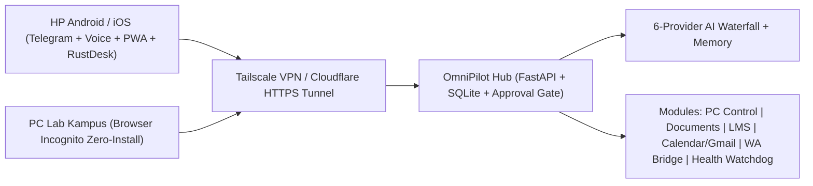

# OmniPilot Hub

**Personal AI Automation, Smart Schedule Watchdog & Zero-Install Remote PC Command Center** untuk Windows, HP (Android/iOS), dan PC Lab Kampus.

OmniPilot Hub memungkinkan Anda mengendalikan laptop Windows dari jarak jauh menggunakan **Telegram Bot (teks & voice note)** maupun **Web Command Center PWA (Glassmorphism UI)**—lengkap dengan memori percakapan AI, multi-provider AI gratis (anti-kehabisan kuota), pembuatan dokumen otomatis, otomasi LMS, rangkuman WhatsApp/Gmail yang aman, serta kontrol layar & mouse/keyboard langsung di browser tanpa install aplikasi di PC umum.

---

## Fitur Utama

- **Dual Remote Control**:
  - **Web Command Center PWA**: Antarmuka dark glassmorphism responsif (mobile-first), dapat di-install ke layar utama HP, mendukung real-time WebSocket, **Mode PC Lab / Umum** (`sessionStorage`), dan tombol **Logout Instan**.
  - **Telegram Bot Pribadi**: Terkunci khusus User ID Anda, mendukung chat bebas, **Voice Note (Groq Whisper / Gemini)**, `/screen` (kirim foto layar laptop ke chat), serta tombol inline **Approve / Tolak** dan **Matikan Alarm**.
- **6-Provider Free AI Waterfall + Memori Percakapan**:
  - Estafet otomatis lintas provider gratis jika satu model penuh/503/limit: **Google Gemini -> Groq -> Cerebras -> OpenRouter (`:free`) -> Mistral -> Ollama (Lokal / Cloud)**.
  - Mengingat konteks percakapan sebelumnya + memori fakta jangka panjang (`/ingat`, `/memori`, `/lupa`, `/reset`).
- **Akses Publik Internet & PC Lab Kampus (Zero-Install)**:
  - **Cloudflare HTTPS Tunnel (`START_ALL.bat`)**: Menyalakan server + membuat link publik `https://*.trycloudflare.com` otomatis, menyalinnya ke Clipboard, dan mengirimkannya ke Telegram Anda.
  - **Tailscale Private VPN & Funnel**: Koneksi P2P cepat untuk HP pribadi atau URL permanen `*.ts.net`.
  - **Kontrol Layar, Mouse & Keyboard di Browser**: Klik kiri/kanan/double-click, scroll, ketik teks, shortcut (`Alt+Tab`, `Ctrl+C/V/S`, `Enter`, `Win`), dan kunci layar laptop langsung dari browser Incognito PC Lab.
- **Human-in-the-Loop Approval Gate (Anti-Salah Kirim & Anti-Ban)**:
  - Semua aksi sensitif (kirim Gmail, balas WhatsApp, upload tugas LMS, perintah PowerShell destruktif, dan menutup proses aplikasi `/kill`) **wajib** disetujui lewat 1 klik Approve di HP/Telegram.
- **Jadwal Harian, Smart Escalation Alarm & Watchdog Laptop**:
  - Sinkronisasi jadwal lokal SQLite + Google Calendar (`.ics`), eskalasi alarm 3 tahap (`ntfy` + MacroDroid / Pushover Priority 2 / sirine PC), serta pemantau kesehatan laptop (alert otomatis jika RAM > 94% atau baterai < 20% + perintah `/top` & `/kill`).
- **Pembuat Dokumen & Otomasi LMS**:
  - Generate file `.docx`, `.pdf`, dan `.md` siap unduh dari HP, plus Playwright profil persisten untuk login LMS (SSO/2FA aman) dan pengumpulan tugas.
- **WhatsApp Safe Bridge (Opt-In)**:
  - Bridge Node.js lokal (`127.0.0.1:3005`) dengan jeda ketik natural (2.5–5.5 detik), cooldown anti-ban 10 detik, dan wajib Approval sebelum mengirim balasan.

---

## Arsitektur Singkat



---

## Cara Install & Setup Cepat (3 Langkah untuk Pengguna Baru)

### Prasyarat
- **Windows 10 / 11**
- **Python 3.10+** (unduh di https://www.python.org/downloads/ dan centang **Add python.exe to PATH**)
- **Node.js 20+** *(opsional, hanya jika ingin memakai WhatsApp Safe Bridge)*

### Langkah 1: Clone Repository
```bash
git clone https://github.com/PutuSatria-hash/OmniPilot.git
cd OmniPilot
```

### Langkah 2: Install Otomatis Semua Dependensi Laptop
Double-click **`1_SETUP_LAPTOP_ADMIN.bat`** (klik **Yes** pada izin Administrator), atau jalankan di PowerShell Administrator:
```powershell
powershell -ExecutionPolicy Bypass -File ".\scripts\setup_laptop.ps1" -RemoteDesktop RustDesk -CampusTunnel Both -DisableSleepOnAC -EnableAutoStart
```
Script ini otomatis membuat `.venv`, menginstal seluruh library Python, menyiapkan Chromium Playwright, membuat `.env` awal dengan token acak yang aman, menginstal Tailscale, Cloudflare Tunnel (`cloudflared`), RustDesk, serta membuka Firewall khusus jaringan Tailscale/LAN.

### Langkah 3: Atur `.env` Secara Interaktif (Mudah, Tanpa Edit Manual!)
Double-click **`0_SETUP_ENV_WIZARD.bat`** lalu ikuti panduan di layar (tekan **Enter** untuk melewati integrasi opsional).

### Langkah 4: Jalankan OmniPilot Hub
Pilih sesuai kebutuhan:
- **`START_ALL.bat`** *(Direkomendasikan)*: Menyalakan Server + Link Publik HTTPS (`https://*.trycloudflare.com`) + otomatis menyalin link ke Clipboard & mengirimnya ke Telegram Bot Anda.
- **`2_START_HUB.bat`**: Menyalakan Server lokal / Tailscale + menampilkan **QR Code** di terminal untuk di-scan langsung dari kamera HP.
- **`4_LOGIN_LMS.bat`**: Login sekali ke LMS kampus (cookie SSO/2FA tersimpan lokal di `data/browser_profile/`).
- **`5_START_WHATSAPP_BRIDGE.bat`**: *(Opsional)* Mengaktifkan WhatsApp Safe Bridge dan menampilkan QR Code untuk ditautkan ke HP.

---

## Panduan Konfigurasi `.env` (Referensi Lengkap)

Jika ingin mengedit file `.env` secara manual (disalin dari `.env.example`), berikut daftar variabel utamanya:

| Variabel `.env` | Wajib? | Fungsi & Tempat Mendapatkan |
| :--- | :--- | :--- |
| `API_AUTH_TOKEN` | **Wajib** | Token rahasia login Web PWA & API (otomatis dibuat acak oleh `0_SETUP_ENV_WIZARD.bat`). |
| `TIMEZONE` | Opsional | Default `Asia/Makassar` (WITA). Ganti `Asia/Jakarta` (WIB) atau `Asia/Jayapura` (WIT). |
| `GEMINI_API_KEY` | Disarankan | API key gratis Google AI Studio: https://aistudio.google.com/app/api-keys |
| `GROQ_API_KEY` | Disarankan | API key gratis Groq (untuk **Voice Note Whisper** & fallback super cepat): https://console.groq.com/keys |
| `OPENROUTER_API_KEY` | Opsional | Cadangan model `:free`: https://openrouter.ai/keys |
| `CEREBRAS_API_KEY` | Opsional | Cadangan kuota harian besar: https://cloud.cerebras.ai |
| `MISTRAL_API_KEY` | Opsional | Cadangan Mistral Free Mode: https://console.mistral.ai/api-keys |
| `OLLAMA_MODEL` | Opsional | Model Ollama lokal (`llama3.2:1b`) atau cloud (`gemma4:31b` + `OLLAMA_API_KEY` dari https://ollama.com/settings/keys). |
| `TELEGRAM_BOT_TOKEN` | Disarankan | Buat bot baru di Telegram `@BotFather` dengan `/newbot`. |
| `TELEGRAM_ALLOWED_USER_ID` | Disarankan | Angka ID akun Telegram Anda (cek di `@userinfobot`) agar bot terkunci khusus untuk Anda. |
| `GOOGLE_CALENDAR_ICS_URL` | Opsional | Google Calendar -> *Settings* -> *Integrate calendar* -> **Secret address in iCal format** (`/private-.../basic.ics`). |
| `LMS_BASE_URL` | Opsional | URL halaman dashboard LMS kampus Anda. |
| `RUSTDESK_PC_ID` | Opsional | Angka ID 9 digit RustDesk PC (jangan isi password di `.env`). |
| `WHATSAPP_ENABLED` | Opsional | Set `true` hanya setelah menjalankan `5_START_WHATSAPP_BRIDGE.bat` dan scan QR. |
| `NTFY_TOPIC` / `PUSHOVER_*` | Opsional | Kanal alarm darurat bypass silent untuk HP (panduan lengkap di `docs/PREPARE_LAPTOP_DAN_HP.md`). |

---

## Daftar Perintah Cepat (Telegram & Web Chat)

| Perintah | Fungsi |
| :--- | :--- |
| *(Chat bebas / Voice Note)* | Langsung diproses oleh AI Agent dengan 14 tool kontrol laptop & memori percakapan |
| `/pc` | Cek CPU, RAM, baterai, disk, IP lokal, dan IP Tailscale |
| `/top` & `/kill <nama.exe>` | Lihat aplikasi pemakan RAM terbesar & tutup aplikasi berat (wajib Approve) |
| `/screen` | Ambil tangkapan layar laptop terkini (foto langsung di Telegram / tab layar di PWA) |
| `/tunnel` | Lihat link publik HTTPS aktif untuk PC Lab Kampus |
| `/buka <app>` | Buka `antigravity`, `vscode`, `chrome`, `terminal`, `explorer`, atau `rustdesk` |
| `/doc Judul \| Isi` | Buat dokumen `.docx` otomatis siap unduh |
| `/jadwal` & `/tambah_jadwal HH:MM Judul` | Lihat jadwal hari ini & tambah agenda baru |
| `/ingat <fakta>` / `/memori` / `/lupa <id>` | Kelola memori jangka panjang AI tentang preferensi Anda |
| `/reset` | Bersihkan riwayat percakapan channel saat ini |
| `/models` | Cek daftar provider AI gratis yang aktif & model terakhir yang merespons |
| `/lms` / `/gmail` / `/wa` | Cek tugas LMS, email masuk, atau rangkuman pesan WhatsApp |

---

## Dokumentasi Tambahan & Keamanan

- Panduan detail setup Laptop, Android, iOS, MacroDroid, dan PC Lab Kampus: [`docs/PREPARE_LAPTOP_DAN_HP.md`](docs/PREPARE_LAPTOP_DAN_HP.md)
- Roadmap pengembangan fitur: [`docs/ROADMAP_IDE_PENGEMBANGAN.md`](docs/ROADMAP_IDE_PENGEMBANGAN.md)
- **Aturan Keamanan**:
  - File `.env`, folder `data/` (database & cookie sesi), `outputs/`, dan sesi WhatsApp otomatis diabaikan oleh `.gitignore` agar kredensial pribadi tidak pernah ikut terunggah ke GitHub.
  - Saat mengakses dari **PC Lab Kampus / komputer umum**, selalu gunakan mode **Incognito**, centang **Mode PC Lab / Umum**, dan tekan **Logout** sebelum menutup browser.

---

## Verifikasi / Pengujian (Untuk Developer)

```powershell
.\.venv\Scripts\pytest.exe -v
```
