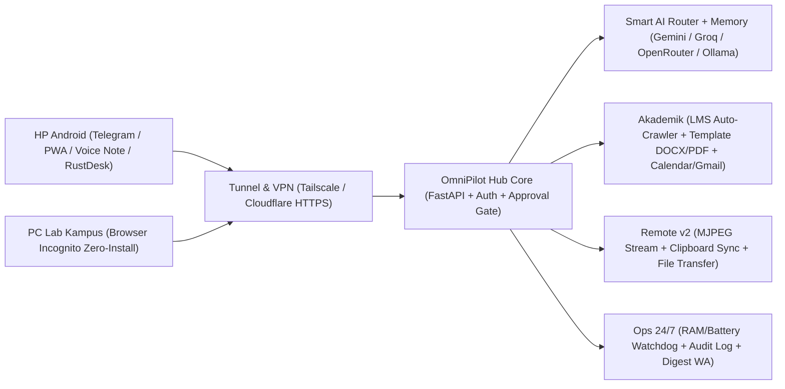

# Roadmap & Kumpulan Ide Pengembangan — OmniPilot Hub v2

Dokumen ini merangkum ide pengembangan strategis untuk **OmniPilot Hub** berdasarkan arsitektur yang sudah berjalan (Laptop Windows, HP Android/iOS, Telegram Bot pribadi, Glassmorphism Web PWA, RustDesk, Tailscale, Cloudflare Tunnel, LMS Playwright, WhatsApp Safe Bridge, dan Multi-Provider Free AI Waterfall).

Seluruh ide dirancang agar **ringan terhadap RAM laptop**, **aman untuk akses PC Lab Kampus**, dan **mempercepat workflow harian Boss**.

---

## Ranking Prioritas Utama (#1 s.d. #11 — Urutan Paling Dibutuhkan)

Ranking disusun berdasarkan **dampak nyata pada workflow harian Boss**, **kesiapan API/infrastruktur yang sudah Boss pasang malam ini** (termasuk `GROQ_API_KEY`, LMS session, Telegram, Cloudflare Tunnel), dan **kondisi RAM laptop Boss (~85–90% terpakai)**.

| Rank | Gelombang | Fitur / Ide | Dampak | Usaha | Alasan Utama Prioritas |
| :--- | :--- | :--- | :--- | :--- | :--- |
| **#1** | **Wave 1 (Wajib Duluan)** | **Memori Percakapan Multi-Turn & Profil Boss** (Ide #8) | 10/10 | Kecil | Membuat semua chat bebas di Telegram/PWA langsung nyambung (bisa revisi dokumen, lanjutan perintah, ingat preferensi Boss) tanpa beban RAM. |
| **#2** | **Wave 1 (Wajib Duluan)** | **`START_ALL.bat` + Auto-Send URL Tunnel ke Telegram** (Ide #11) | 9.5/10 | Kecil | 1 klik menyalakan Hub + Tunnel + WA Bridge, dan URL HTTPS PC Lab otomatis dikirim ke bot Telegram pribadi tanpa perlu salin manual sebelum berangkat. |
| **#3** | **Wave 1 (Wajib Duluan)** | **Voice Note Command via Telegram (Groq Whisper Gratis)** (Ide #1) | 9.5/10 | Kecil–Sedang | `GROQ_API_KEY` sudah Boss pasang; kirim suara sambil jalan langsung dieksekusi < 1 detik gratis dan 0 MB RAM laptop. |
| **#4** | **Wave 1 (Wajib Duluan)** | **Watchdog RAM/Baterai Laptop + `/top` Tutup Proses Berat** (Ide #10) | 9/10 | Kecil | RAM laptop Boss sering menyentuh 85–90%; fitur ini menjaga laptop rumah tidak nge-hang saat ditinggal ke kampus. |
| **#5** | **Wave 2 (Prioritas Tinggi)** | **Remote File Manager & Transfer Drag-and-Drop** (Ide #6) | 9/10 | Sedang | Ambil/kirim file tugas antara laptop rumah dan PC Lab Kampus langsung lewat browser Incognito tanpa flashdisk. |
| **#6** | **Wave 2 (Prioritas Tinggi)** | **Auto-Crawler Deadline LMS Terjadwal (tiap 6 jam)** (Ide #2) | 8.5/10 | Sedang | Sesi LMS sudah tersimpan; deteksi otomatis tugas/kuis baru < 48 jam agar tidak pernah terlewat deadline. |
| **#7** | **Wave 2 (Prioritas Tinggi)** | **MJPEG Smooth Stream + Clipboard Sync 2-Arah** (Ide #5) | 8.5/10 | Sedang | Kontrol layar di browser PC Lab jauh lebih halus + copy-paste teks/kode langsung antara PC Lab dan laptop rumah. |
| **#8** | **Wave 2 (Prioritas Tinggi)** | **Unified Morning & Evening Briefing** (Ide #4) | 8/10 | Kecil–Sedang | 1 pesan ringkas merangkum Jadwal + LMS + Gmail + Digest WA penting (optimal setelah link ICS Calendar diganti ke Secret address). |
| **#9** | **Wave 3 (Penyempurnaan)** | **Template Dokumen Kampus + Tombol 1-Klik Stage LMS** (Ide #3) | 8/10 | Sedang | Mempercepat pembuatan makalah/laporan sesuai format cover & NIM Boss. |
| **#10** | **Wave 3 (Penyempurnaan)** | **Smart AI Router & Statistik Kuota Provider** (Ide #9) | 7.5/10 | Sedang | Routing otomatis model cepat vs model pintar + pantau pemakaian kuota tiap provider gratis di `/models`. |
| **#11** | **Wave 3 (Penyempurnaan)** | **Multi-Workspace Launcher & `/git` Status dari HP** (Ide #7) | 7/10 | Kecil | Praktis saat mengelola banyak proyek sekaligus (Roblox Studio, tugas kuliah, web) dari HP. |

> [!IMPORTANT]
> **Rekomendasi Eksekusi Besok**: Kerjakan **Wave 1 (Rank #1 sampai #4)** terlebih dahulu karena seluruh bahannya sudah siap, cepat dibangun, nol beban RAM tambahan, dan efeknya langsung terasa setiap hari.

---

## Arsitektur Target OmniPilot Hub v2

---

## Pilar 1: Produktivitas Kampus & Akademik

### 1. Voice Note Command (Perintah Suara dari Telegram & PWA)
- **Konsep**: Boss cukup mengirim pesan suara sambil jalan atau berkendara (*"Catat tugas Basis Data deadline Jumat, buat kerangka laporan Word, dan cek WA penting"*).
- **Teknis**: Transkripsi audio memakai **Groq Whisper API (gratis & < 1 detik)** dengan cadangan multimodal Gemini, lalu teks diteruskan otomatis ke `AgentEngine`.
- **Dampak RAM Laptop**: 0 MB (diproses di cloud).
- **Prioritas**: Sangat Tinggi — percepatan workflow HP paling terasa.

### 2. Auto-Crawler Deadline LMS Terjadwal + Pengingat Otomatis
- **Konsep**: Background worker Playwright berjalan diam-diam setiap 6 jam memakai sesi `data/browser_profile/` yang sudah tersimpan untuk mendeteksi tugas/kuis baru di LMS.
- **Teknis**: Tugas baru dengan tenggat < 48 jam otomatis masuk tabel jadwal lokal + mengirim notifikasi ringkas ke Telegram Boss.
- **Catatan**: Dijalankan terjadwal dan browser langsung ditutup setelah selesai agar tidak memakan RAM.

### 3. Template Dokumen Akademik Kampus + Pipeline 1-Klik ke LMS
- **Konsep**: Menyediakan template `.docx` & `.pdf` siap pakai (halaman sampul kampus, NIM/Nama Boss, format bab/subbab, daftar pustaka rapi) serta tombol **"Stage Upload LMS"** langsung pada kartu dokumen di Web PWA.
- **Keamanan**: Tetap wajib melewati **Approval Gate** + screenshot bukti sebelum tombol submit ditekan.

### 4. Morning & Evening Unified Briefing (1 Pesan Merangkum Semua)
- **Konsep**: Setiap pagi (misal `06:30`) dan malam (`20:30`), Telegram mengirim 1 ringkasan padat berisi:
  1. Jadwal Google Calendar & lokal hari itu (setelah link ICS diubah ke *Secret address*).
  2. Daftar deadline LMS terdekat.
  3. Ringkasan email penting dari Gmail.
  4. Ringkasan pesan WhatsApp belum dibaca yang diprioritaskan oleh AI (tanpa auto-reply).

---

## Pilar 2: Remote Layar & Akses PC Lab Kampus v2

### 5. Upgrade Tab "PC & Layar": MJPEG Smooth Stream + Clipboard Sync 2-Arah
- **Konsep**: Mengganti refresh gambar per 2 detik menjadi stream **MJPEG adaptif (8–15 FPS)** di browser Incognito PC Lab Kampus, ditambah fitur **Copy-Paste 2 arah** antara PC Lab dan laptop rumah.
- **Manfaat**: Coding ringan, pindah file teks/link, atau mengoperasikan Antigravity dari browser PC Lab terasa jauh lebih mulus tanpa perlu install RustDesk di komputer lab.

### 6. Remote File Manager & Drag-and-Drop Transfer (Tanpa Flashdisk)
- **Konsep**: Tab baru **Files** di Web PWA untuk menelusuri folder aman (misal `outputs/`, `Documents/`, folder proyek kuliah), mengunduh file tugas langsung ke PC Lab Kampus, atau mengunggah hasil praktikum dari PC Lab ke laptop rumah.
- **Keamanan**: Dibatasi pada daftar folder yang diizinkan (*allowlist*) agar tetap aman.

### 7. Multi-Workspace Launcher & Git Status dari HP
- **Konsep**: Simpan daftar preset proyek Boss (misal `SetUp Automation`, `Roblox Studio`, proyek tugas akhir) di tab **PC & Layar** untuk sekali klik buka di Antigravity/VS Code, serta perintah `/git` untuk mengecek perubahan atau commit terakhir dari HP.

---

## Pilar 3: Kecerdasan AI & Manajemen Kuota

### 8. Memori Percakapan Multi-Turn & Profil Preferensi Boss
- **Konsep**: Saat ini setiap chat bersifat satu giliran (*stateless*). Dengan menyertakan 8–10 pesan terakhir + memori fakta penting (nama kampus, jurusan, format dokumen favorit, daftar kontak prioritas), AI akan nyambung saat Boss menyuruh *"revisi paragraf kedua dokumen yang barusan dibuat"* atau *"balas pesan dia tadi bilang saya lagi di lab"*.

### 9. Smart AI Router & Dashboard Kuota Provider
- **Konsep**: Memisahkan pemilihan model otomatis sesuai jenis perintah:
  - Perintah cepat & tool calling -> `gemini-3.5-flash-lite` atau `groq/llama-3.3-70b-versatile`.
  - Penulisan dokumen panjang / analisis rumit -> model reasoning terbesar yang sedang sehat di waterfall.
  - Menampilkan statistik sukses/gagal dan latensi tiap provider di `/models`.

---

## Pilar 4: Stabilitas 24/7, Kesehatan Laptop & Keamanan

### 10. Laptop Health Watchdog & Remote Process Manager
- **Latar Belakang**: Saat pengecekan tadi, RAM laptop Boss sering menyentuh **85–90% (14 / 15.8 GB)**.
- **Fitur**:
  - Notifikasi otomatis ke Telegram jika **RAM > 94%**, **Baterai < 20% (tidak tercolok)**, atau **WhatsApp Bridge / Cloudflare Tunnel terputus**.
  - Perintah `/top` (atau panel di PWA) untuk melihat 5 aplikasi pemakan RAM terbesar dan opsi aman menutup aplikasi non-sistem dari HP.

### 11. Master Launcher 1-Klik (`START_ALL.bat`) + Auto-Restart + Audit Log
- **Konsep**: Satu pengelola untuk menyalakan `OmniPilot Hub + Cloudflare Tunnel + WhatsApp Bridge` secara bersamaan, otomatis me-restart modul jika crash, mengirim URL Cloudflare Tunnel terbaru langsung ke Telegram Boss saat laptop menyala (sehingga Boss tidak perlu menyalin URL secara manual sebelum berangkat ke kampus!), serta mencatat log audit setiap login dari PC Lab Kampus.

> [!TIP]
> Fitur **Auto-Send URL Cloudflare Tunnel ke Telegram** sangat menghemat waktu: setiap kali laptop rumah menyala atau tunnel berubah, link HTTPS baru langsung masuk ke chat pribadi bot Telegram Anda sehingga tinggal klik saat sampai di PC Lab Kampus.

---

## Perbandingan 2 Paket Eksekusi (Opsi A vs Opsi B)

Besok Boss cukup memilih paket mana yang ingin dikerjakan lebih dulu (atau mencentang nomor ide tertentu):

| Aspek | Opsi A: Paket Produktivitas & Workflow Harian | Opsi B: Paket Remote PC Lab & Stabilitas 24/7 |
| :--- | :--- | :--- |
| **Fokus Utama** | Kecepatan kerja dari HP & otomasi kuliah/tugas | Pengalaman remote laptop rumah dari PC Lab & ketahanan sistem |
| **Ide yang Dikerjakan** | **#1** Voice Note Telegram (Groq Whisper), **#2** Auto-Crawler Deadline LMS, **#3** Template Dokumen Kampus, **#4** Unified Daily Briefing, **#8** Memori Percakapan Multi-Turn | **#5** MJPEG Stream + Clipboard Sync, **#6** Remote File Transfer (tanpa flashdisk), **#10** RAM/Baterai Watchdog + `/top`, **#11** `START_ALL.bat` + Auto-Send URL Tunnel ke Telegram |
| **Dampak Langsung** | Prompt sambil jalan pakai suara, tidak ketinggalan deadline LMS, AI jauh lebih nyambung | Akses dari PC Lab Kampus serasa duduk di depan laptop sendiri, URL tunnel otomatis dikirim ke Telegram, laptop aman dari kehabisan RAM |
| **Estimasi Beban Laptop** | Sangat ringan (mayoritas proses di cloud) | Sangat ringan (streaming adaptif hanya aktif saat tab layar dibuka) |

**Rekomendasi**: Jika jadwal kuliah dan tugas sedang padat, mulai dari **Opsi A** lalu tambahkan **#11 (Auto-Send URL Tunnel ke Telegram)** dari Opsi B sebagai bonus cepat. Jika Boss paling sering mengakses laptop rumah dari **PC Lab Kampus**, mulai dari **Opsi B**.
